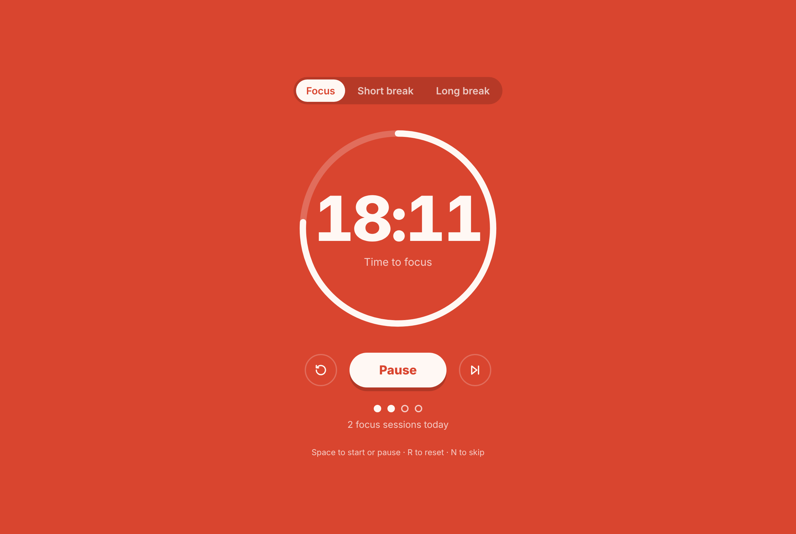
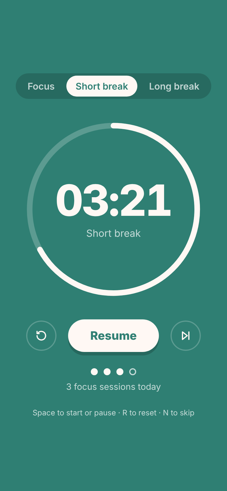

<h1 align="center">Pomodoro Timer</h1>

<p align="center">
  25 minutes of focus, a short break, repeat. After four sessions, a long break.
</p>

<p align="center">
  <a href="https://bezalelchris.github.io/Pomodoro-Timer/"><strong>Live demo</strong></a>
</p>

<p align="center">
  
  
  
  
</p>

<p align="center">
  
  &nbsp;
  
</p>

## Features

- **Focus, short break and long break** modes (25 / 5 / 15 min), each with its own color so you can tell where you are from across the room.
- **Auto-advances** through the cycle: focus → short break, and a long break after every fourth session.
- **Progress ring** that drains as time runs out, plus a live countdown in the browser tab title.
- **Chime** when a session ends, generated with the Web Audio API (no sound files).
- **Keyboard shortcuts:** Space to start/pause, R to reset, N to skip.
- Mobile layout, dark mode, visible focus states and reduced-motion support.

## Engineering notes

| Problem | Fix |
|---|---|
| Counting down with `setInterval(…, 1000)` drifts, and browsers throttle timers in background tabs, so the clock fell behind. | The timer stores an end timestamp and recomputes the remaining time on every tick, so it stays exact even when the tab is hidden. |
| The old version used `alert()` when time was up, which blocks the page. | A chime plus a color and status change signal the switch without interrupting. |

## Run locally

No build step:

```bash
git clone https://github.com/bezalelchris/Pomodoro-Timer.git
cd Pomodoro-Timer
open index.html        # or just double-click it
```

## Roadmap

- Custom session lengths
- Desktop notifications
- Task list attached to each focus session
